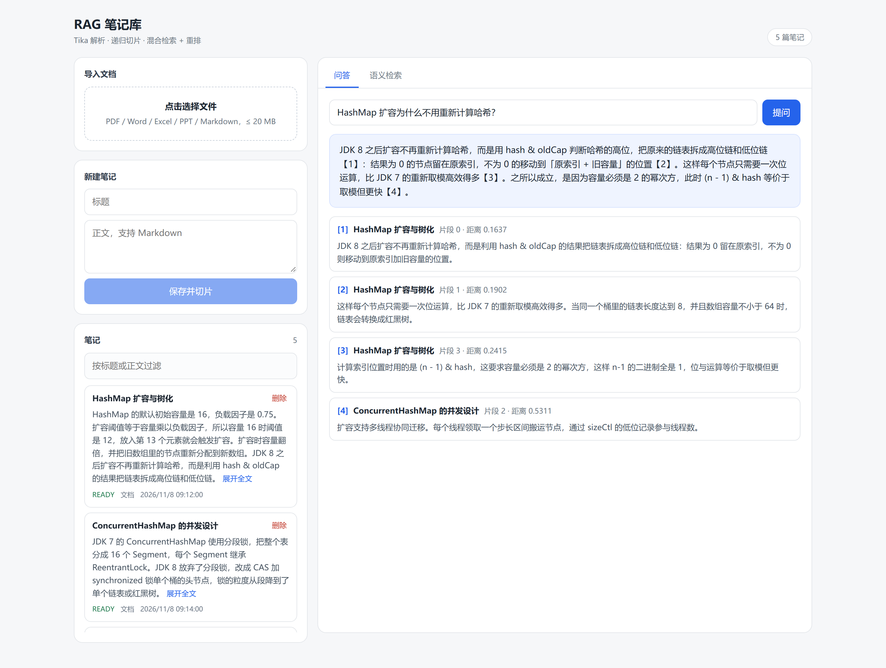
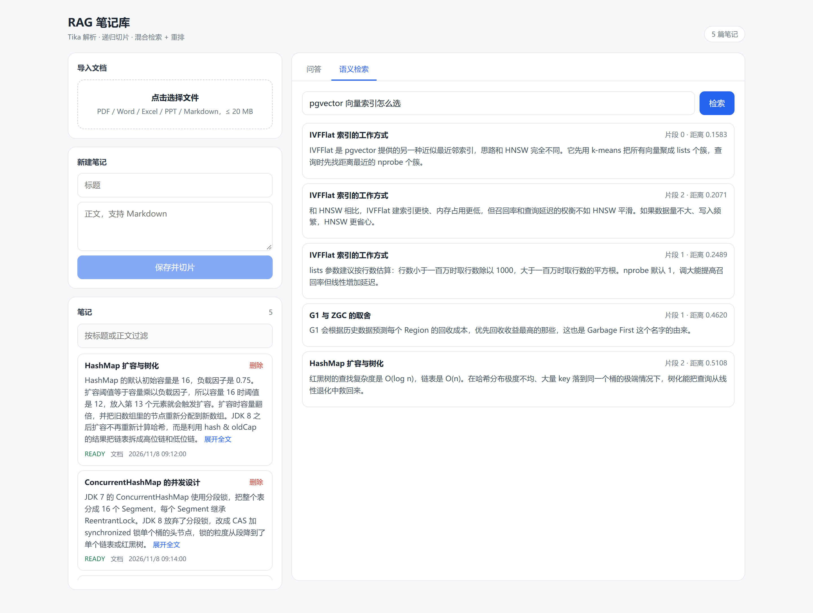
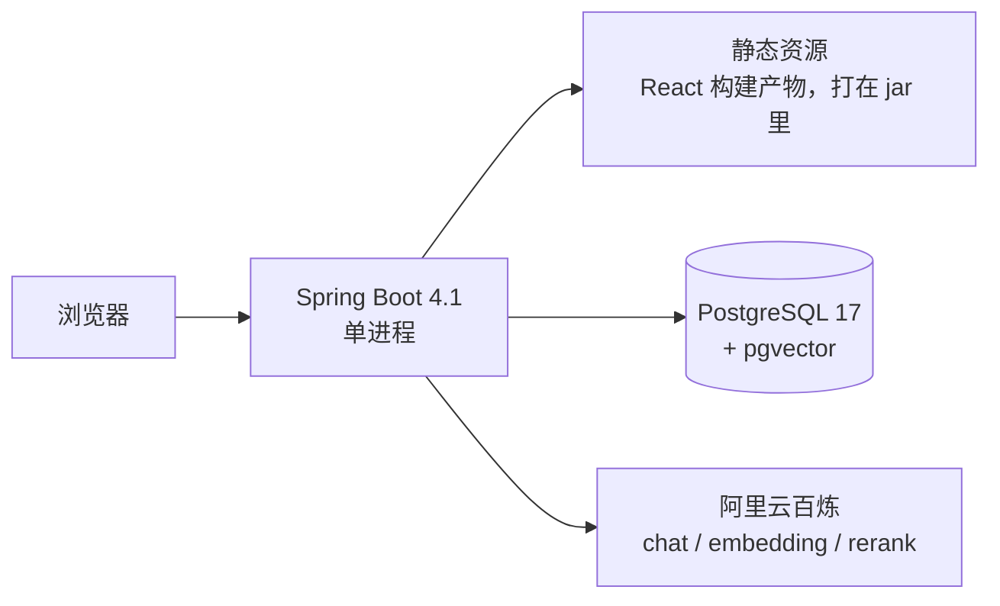

# 企业文档 RAG 问答系统

[](https://github.com/Pastik233/ragkb/actions/workflows/ci.yml)
[](LICENSE)


> 让每一句回答都能点回原文片段 —— 一个可私有化部署、单进程运行的企业文档 RAG 问答系统。

把制度文档、操作手册、论文、课件（PDF / Word / Markdown / 代码等 11 类文档）导入后，
用**向量 + BM25 双路召回 → RRF 融合 → qwen3-rerank 精排**检索，再由大模型基于片段作答并标注引用来源。
后端 Spring Boot，前端 React 构建产物打进同一个 jar，**部署时只有一个进程**，不需要单独的 Node 服务。

## 目录

- [核心特性](#核心特性)
- [效果展示](#效果展示)
- [系统架构](#系统架构)
- [技术栈](#技术栈)
- [快速开始](#快速开始)
- [前端开发模式](#前端开发模式)
- [API](#api)
- [配置](#配置)
- [检索链路](#检索链路)
- [测试](#测试)
- [评测脚本](#评测脚本)
- [目录结构](#目录结构)
- [License](#license)

## 核心特性

- **文档接入**：Apache Tika 统一解析 11 类文档，20MB 文件与 200 万字符上限，文件名路径穿越清洗，解析与索引失败互不牵连。
- **文本切片**：自研递归分块，按「段落 → 换行 → 中文句末 → 逗号 → 英文句号 → 空格 → 硬切」逐级降级，800 字符窗口 + 150 字符重叠，重叠边界对齐到句读。
- **混合检索**：向量 Top20（余弦距离 ≤ 0.75）+ 自研中文 BM25 Top20，RRF（k=60）融合后交 qwen3-rerank 精排；重排异常自动回退融合序。
- **带引用生成**：Prompt 约束「仅依据片段作答 + 句末标注【n】+ 无答案即拒答」，接口同时返回文档名、片段号与距离。
- **索引可运维**：状态机 `PENDING → PROCESSING → READY / FAILED`，支持单篇重建与批量补建（历史数据补齐）。

## 效果展示

**带引用的问答**：答案里每个【n】都对应下方一条原文片段，附文档名、片段序号与余弦距离。

<p align="center">
  
</p>

**语义检索**：只检索不生成，直接给出最相关的片段，适合先定位原文再自己判断。

<p align="center">
  
</p>

> 截图中为示例数据，界面标题为项目改名前版本。

## 系统架构



三种外部依赖各司其职：数据库存原文、片段与向量；百炼提供对话、向量化与精排；浏览器拿到的静态资源由同一个 Java 进程直接提供。

## 技术栈

| 层次 | 选型 | 说明 |
|---|---|---|
| 语言 / 运行时 | Java 21 | — |
| 基础框架 | Spring Boot 4.1.2 | WebMVC + JDBC |
| AI 框架 | Spring AI 2.0.0 | `ChatClient` + `EmbeddingModel` |
| 持久层 | MyBatis 4.1（XML 映射）+ Flyway | SQL 全部写在 Mapper XML |
| 向量库 | PostgreSQL 17 + pgvector | `vector(1024)` + HNSW cosine |
| 文档解析 | Apache Tika 3.3.2 | 统一解析 11 类文档 |
| 前端 | React 19 + Vite 7 | 构建产物已入库，打进 jar |
| 模型服务 | 阿里云百炼 | `qwen3.7-text-embedding` / `qwen3-rerank` / `qwen-flash` |

### 模型接入的分层设计

生成层与向量化都走 **Spring AI 2.0**：`ChatClient` 负责对话、`EmbeddingModel` 负责向量化，
分别经 `ChatPort` / `EmbeddingPort` 接口与业务层解耦，统一打百炼的 OpenAI 兼容端点。
框架之外仍保留三件事：批量结果按 `Embedding.getIndex()` 归位、向量经 `PgVector.literal()` 转 pgvector 字面量、
模型名写入 `embedding_model` 列做防漂移过滤。

rerank 走百炼原生协议；Spring AI 2.0 GA 核心没有开箱即用的 rerank 模型，
社区版 spring-ai-alibaba 仅到 `2.0.0-M1.1` 里程碑版（对应 Spring AI 2.0.0-M1），与本项目 GA 版错配且会带进一整套自动配置，
故保留自研 `RestClient`，用 `RerankPort` 隔离，**不引入 Advisor 链**。

> **混合检索、RRF 融合、距离阈值过滤均为原生 SQL + 自研 BM25，不依赖任何框架的 VectorStore。**

## 快速开始

**环境要求**：JDK 21+、Docker（或本机 PostgreSQL 15+ 且已装 pgvector）、一个阿里云百炼 API Key。
Node 和 Maven 都不用单独装：前端构建产物已随仓库提交，默认构建**不需要 Node、也不需要联网**；Maven 用仓库自带的 `mvnw`。

```bash
# 1. 起数据库（pgvector 官方镜像，自带 vector 扩展）
docker compose up -d

# 2. 配 Key（Windows PowerShell 用 $env:DASHSCOPE_API_KEY="sk-xxx"）
export DASHSCOPE_API_KEY=sk-your-key
# 数据库默认连 localhost:5432/ragkb，用户 postgres/postgres，可用下面三个变量覆盖
# export DB_URL=jdbc:postgresql://localhost:5432/ragkb
# export DB_USERNAME=postgres
# export DB_PASSWORD=postgres

# 3. 构建（Windows 用 mvnw.cmd；前端产物已在仓库里，直接打进 jar）
./mvnw clean package

# 4. 启动，浏览器打开 http://localhost:8080
java -jar target/ragkb-1.0.0.jar
```

首次启动 Flyway 自动建表（`V1`–`V7`），不需要手工执行 SQL。环境变量清单见 [`.env.example`](.env.example)（只是清单，Spring Boot 不会自动读 `.env`）。

> **前端怎么进 jar**：`frontend/` 用 Vite 构建，产物提交在 `src/main/resources/static`，
> 打包时由 resources 插件复制进 jar 的 `BOOT-INF/classes/static`，所以**运行时只有一个 Java 进程，不需要 Vite**。
> 改了前端源码后，用 profile 重新构建并把产物一起提交：
>
> ```bash
> ./mvnw -Dfrontend.build clean package     # 自动下载 Node v22.12.0 → npm ci → vite build
> git add src/main/resources/static && git commit
> ```
>
> 首次跑这个 profile 需要联网下载 Node 与 npm 依赖；CI 会校验提交的产物和源码是否一致。

## 前端开发模式

需要热更新时再单独跑 Vite（`frontend/vite.config.js` 里已把 `/api` 代理到 8080）：

```bash
cd frontend
npm install
npm run dev      # http://localhost:5173，接口转发到 http://localhost:8080
```

## API

统一前缀 `/api`。

| 方法 | 路径 | 说明 |
|---|---|---|
| POST | `/api/documents` | multipart 上传文档（字段名 `file`），解析 + 切片 + 建索引 |
| GET | `/api/documents/{id}/chunks` | 查看某篇文档的切片（正文截断预览） |
| POST | `/api/documents/{id}/reindex` | 重建单篇索引 |
| POST | `/api/documents/reindex-pending` | 批量补建未完成索引的文档，返回 `{total, succeeded, failed}` |
| GET | `/api/notes` | 笔记列表（只回 200 字预览与字数） |
| GET | `/api/notes/{id}` | 笔记详情（含正文） |
| GET | `/api/notes/search?keyword=` | 标题关键字搜索 |
| GET | `/api/notes/semantic?q=&k=5` | 混合检索，返回片段 + 距离 + 所属文档 |
| POST | `/api/notes` | 新建笔记，body `{"title":"...","content":"..."}` |
| DELETE | `/api/notes/{id}` | 删除笔记（204 / 404） |
| POST | `/api/ask` | 问答，body `{"q":"...","k":5}`，返回 `answer` + `sources` |

`requests.http` 里有全部接口的可执行示例。

## 配置

| 变量 | 默认值 | 说明 |
|---|---|---|
| `DASHSCOPE_API_KEY` | 空 | 同时供 Spring AI（chat + embedding）与自研 rerank 客户端使用；不配也能启动，但上传与问答会失败 |
| `DB_URL` | `jdbc:postgresql://localhost:5432/ragkb` | 数据库地址 |
| `DB_USERNAME` / `DB_PASSWORD` | `postgres` / `postgres` | 数据库账号 |

`src/main/resources/application.yaml` 里的检索与模型参数：

| 键 | 默认 | 作用 |
|---|---|---|
| `app.rag.vector-candidates` | 20 | 向量通道召回条数 |
| `app.rag.keyword-candidates` | 20 | BM25 通道召回条数 |
| `app.rag.max-distance` | 0.75 | 余弦距离阈值，超出即丢弃 |
| `app.rag.rrf-k` | 60 | RRF 融合常数 |
| `app.rag.rerank-candidates` | 20 | 送进重排的候选数 |
| `app.rag.hnsw-ef-search` | 100 | HNSW 检索宽度（随连接初始化下发） |
| `app.ingestion.chunk-max-chars` / `chunk-overlap-chars` | 800 / 150 | 切片窗口与重叠 |
| `app.ingestion.embedding-batch-size` | 10 | 批量向量化条数 |
| `app.embedding.model` / `app.chat.model` | `qwen3.7-text-embedding` / `qwen-flash` | 换 embedding 模型须全量重建索引；两者分别注入 Spring AI 的 embedding / chat 配置 |
| `spring.ai.openai.base-url` | `https://dashscope.aliyuncs.com/compatible-mode/v1` | Spring AI chat 与 embedding 共用的 OpenAI 兼容端点 |
| `spring.ai.openai.chat.model` / `embedding.model` | `${app.chat.model}` / `${app.embedding.model}` | 与 `app.*` 保持单一数据源，避免 `embedding_model` 列名与实际调用模型不一致 |
| `spring.ai.openai.chat.timeout` / `embedding.timeout` | 60s | 官方 SDK 的读超时，防止上游卡住耗光 Tomcat 线程 |
| `app.http.connect-timeout-seconds` / `read-timeout-seconds` | 5 / 60 | rerank 客户端的 HTTP 超时；read 值同时被上面两项复用 |

## 检索链路

1. 文档 → Tika 抽正文 → 归一化空白 → 递归切片（800/150，边界对齐句读）。
2. 切片按 10 条/批经 Spring AI `EmbeddingModel` 调用 `qwen3.7-text-embedding`，按 `index` 归位后以 `CAST(? AS vector)` 写入 `note_chunks`（`vector(1024)` + HNSW cosine）。
3. 查询：向量召回（按 `embedding_model` 过滤，防模型漂移）+ BM25 召回，各自 Top20。
4. RRF 融合：`score = Σ 1/(60 + rank)`，只看排名，不需要对齐两路量纲。
5. qwen3-rerank 精排 Top20，异常回退融合序。
6. 距离阈值过滤 → Prompt 拼接片段（带【n】编号）→ 经 `ChatPort` 交给 Spring AI `ChatClient`（qwen-flash）作答 → 返回 `answer` + `sources`。

BM25 是手写的：中文按连续汉字串切二元组（「线程安全」→ 线程/程安/安全），带停用词过滤、文档长度归一化（k1=1.2, b=0.75），
倒排表按文档增量维护（重切片只重算该篇、读写锁分离、首次查询才懒加载全量）；查询向量与重排结果各带一级 LRU 缓存。

## 测试

```bash
./mvnw test                                                    # 单元测试，不需要数据库和外网
./mvnw -DskipTests package                                      # 只打 jar（Windows 用 mvnw.cmd）
./mvnw -Dragkb.probe=true -Dtest='SpringAi*ProbeTest' test  # 真调百炼的兼容性探针（需 Key）
```

覆盖切片边界、RRF 融合与阈值过滤、重排回退、BM25 增量索引、索引状态机等；外部模型与仓储全部用 Mockito 打桩。
两个兼容性探针分别验证：官方 SDK 能连上百炼的 `/chat/completions` 与 `/embeddings`、笔记正文里的花括号不会被当成模板变量、
批量向量结果按 `index` 归位。默认双重守卫（有 Key + 显式开关）跳过，避免误调付费接口。

## 评测脚本

`eval/` 下有离线评测脚本与语料（`corpus` ~ `corpus5`），输出 Hit@K、MRR、平均耗时与随机基线：

```bash
bash eval/seed.sh                                        # 用 corpus ~ corpus5 灌库并导出 chunks.json
node eval/run-eval.mjs                                   # 基础召回评测
node eval/run-eval-hard.mjs                              # 难样本
node eval/run-eval-multilabel.mjs                        # 多标签
node eval/run-eval-real.mjs                              # 真实语料
node eval/run-eval-ids.mjs                               # 编号/字面匹配
```

默认都打 `http://localhost:8080`，可用 `RAG_BASE` / `RAG_K` 覆盖。

## 目录结构

```
src/main/java/com/example/ragkb/
├── common/        LruCache、PgVector、HttpClients（rerank 用的 RestClient 工厂）
├── document/      Tika 解析、递归切片、索引状态机、文档接口
├── note/          笔记/片段模型、自研 BM25、混合检索、三个 Port 接口与 Spring AI 适配器、接口
└── RagkbApplication.java
src/main/resources/
├── db/migration/  Flyway V1–V7
├── static/        React 构建产物（已入库，规范见「快速开始」）
└── application.yaml
frontend/          React 19 + Vite 7（构建产物被打进 jar）
eval/              评测脚本与语料
docs/              README 用的界面截图
```

## License

基于 [MIT](LICENSE) 协议开源。向量检索能力由 [pgvector](https://github.com/pgvector/pgvector)、模型接入由 [Spring AI](https://github.com/spring-projects/spring-ai)、文档解析由 [Apache Tika](https://tika.apache.org/) 提供。
